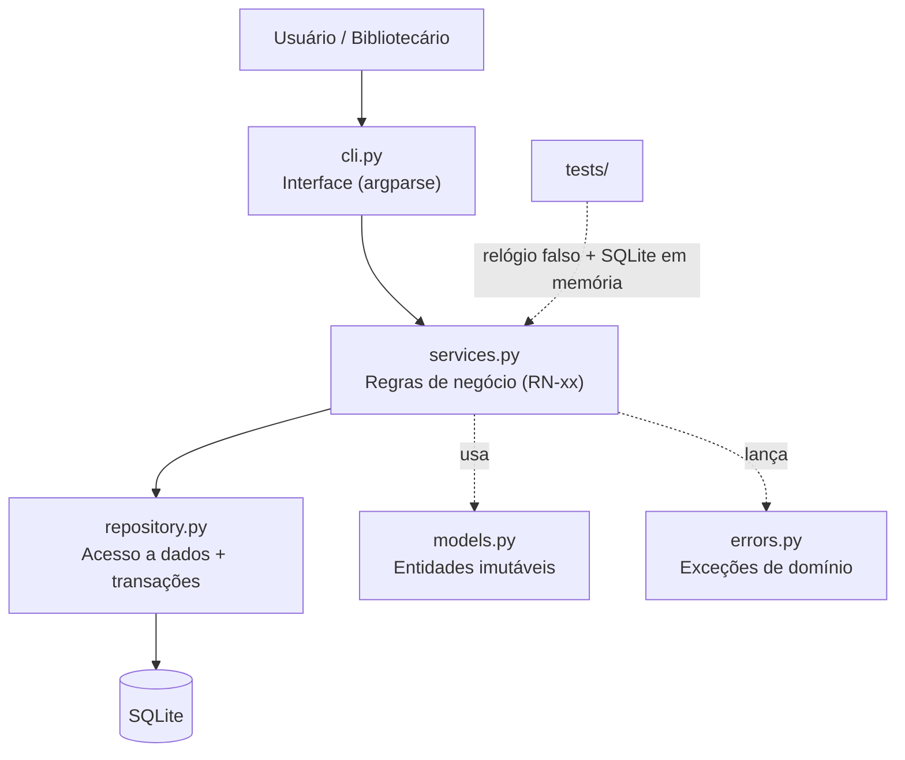
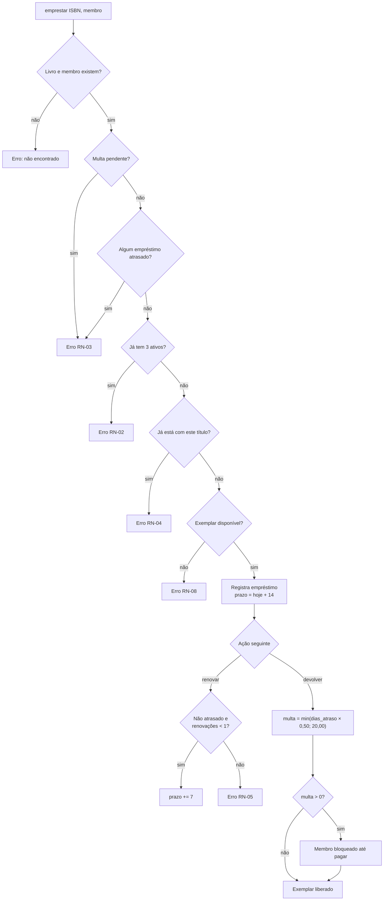

# 📚 BiblioLivre


Sistema de empréstimos para **bibliotecas comunitárias** (escolas, associações de bairro, ONGs) que hoje controlam o acervo em cadernos ou planilhas, perdendo livros e sem controle de prazos.

O BiblioLivre controla acervo, membros, empréstimos, renovações, atrasos e multas pela linha de comando, com banco SQLite local — sem servidor, sem internet, sem dependências externas.

> Projeto desenvolvido com **SDD (Spec-Driven Development)**: a especificação em [`docs/SPEC.md`](docs/SPEC.md) é a fonte da verdade; código e testes referenciam os IDs das regras (RF-xx / RN-xx).

> **Entrega 3 — Entrega Final:** release oficial [`v1.0.0`](https://github.com/dantasz15/bibliolivre/releases/tag/v1.0.0), publicada a partir de `main`; o PR #9 foi integrado e `main` é a branch padrão. CI e CodeQL passaram no commit de release. O trabalho é individual: não houve aprovação independente registrada e o número de aprovações obrigatórias foi configurado como zero; a regra continua exigindo PR. A gravação/publicação do vídeo demonstrativo permanece pendente. Consulte [`docs/GOVERNANCA.md`](docs/GOVERNANCA.md) para o estado detalhado.

## Sumário
- [Instalação e execução](#instalação-e-execução)
- [Uso](#uso)
- [Testes](#testes)
- [Arquitetura](#arquitetura)
- [Fluxo da aplicação](#fluxo-da-aplicação)
- [Documentação do projeto](#documentação-do-projeto)
- [Equipe](#equipe)

## Instalação e execução

**Requisitos:** Python 3.10+ (nenhuma biblioteca externa) **ou** Docker.

### Opção A — Python local
```bash
git clone https://github.com/dantasz15/bibliolivre.git
cd bibliolivre
python3 -m venv .venv
source .venv/bin/activate
python -m pip install -e .
python -m bibliolivre --help
```

Para lint e relatório de cobertura, instale as dependências opcionais de desenvolvimento:

```bash
python -m pip install -e ".[dev]"
make lint
make coverage
```

### Opção B — Docker (ambiente padronizado)
```bash
docker build --target runtime -t bibliolivre:1.0.0 .
docker volume create bibliolivre-dados
docker run --rm -v bibliolivre-dados:/dados bibliolivre:1.0.0 livros
```

### Opção B2 — Docker Compose
```bash
docker compose run --build --rm test  # executa o harness na imagem de teste
docker compose run --rm app livros    # dados persistem em volume nomeado
```

### Opção C — Make
```bash
make test     # roda a suíte
make demo     # executa um cenário de demonstração
```

## Uso

```bash
python -m bibliolivre livro-add 978-85-359-0277-8 "Dom Casmurro" "Machado de Assis" --exemplares 2
python -m bibliolivre membro-add "Ana Souza" ana@email.com
python -m bibliolivre emprestar 9788535902778 1
python -m bibliolivre livros
python -m bibliolivre renovar 1
python -m bibliolivre devolver 1
python -m bibliolivre atrasados
python -m bibliolivre multa 1
python -m bibliolivre pagar 1
python -m bibliolivre membro-anonimizar 1   # LGPD
```

O arquivo do banco é `bibliolivre.db` (altere com `--db caminho` ou variável `BIBLIO_DB`).
Códigos de saída: `0` sucesso, `1` erro de regra/validação, `2` argumento inválido, `3` falha no banco (mensagens em *stderr*, nunca stack trace).

### Regras principais (resumo da SPEC)
| Regra | Descrição |
|---|---|
| RN-01 | Prazo de empréstimo: 14 dias |
| RN-02 | Máximo 3 empréstimos simultâneos por membro |
| RN-03 | Membro com multa pendente **ou** empréstimo atrasado não pode pegar livro |
| RN-04 | Membro não pode ter 2 exemplares do mesmo título |
| RN-05 | 1 renovação (+7 dias), somente se não estiver atrasado |
| RN-06 | Multa de R$ 0,50 por dia de atraso (devolver no dia do prazo não gera multa) |
| RN-07 | Teto de multa: R$ 20,00 por empréstimo |
| RF-09 | Anonimização de membro a pedido do titular (LGPD) |
| RNF-07 | Transações seguras entre conexões no mesmo SQLite local; não validado em filesystem de rede |

## Testes

```bash
python -m unittest discover -s tests -t . -v
make coverage              # testes + relatório texto/XML, limiar >=95%
make lint                  # Ruff
./scripts/run_tests.sh     # log da execução simples em docs/evidencias/
```

Resultados reproduzidos, versão do Python, quantidade de testes, cobertura medida e links das execuções oficiais estão em [`docs/TESTES.md`](docs/TESTES.md). O workflow de CI valida Ruff, testes com limiar de cobertura de 95% em Python 3.10–3.12 e Docker; CodeQL roda em workflow separado. Confira os status atuais nas abas [Actions](https://github.com/dantasz15/bibliolivre/actions) e [Security](https://github.com/dantasz15/bibliolivre/security/code-scanning).

## Agentes de IA

O repositório inclui arquivos de instrução para Claude Code (`CLAUDE.md`), Codex CLI (`AGENTS.md`) e Cursor (`.cursorrules`). Esses arquivos são orientações versionadas e não comprovam a execução de cada ferramenta; os limites da evidência estão em [`docs/AGENTES_IA.md`](docs/AGENTES_IA.md).

## Decisões arquiteturais (ADRs — resumo)
| ADR | Decisão | Principal trade-off |
|---|---|---|
| [001](docs/adr/ADR-001-arquitetura-em-camadas.md) | Camadas CLI → Serviço → Repositório | Testabilidade × um pouco mais de código |
| [002](docs/adr/ADR-002-sqlite.md) | SQLite local | Zero instalação × sem multiusuário em rede |
| [003](docs/adr/ADR-003-cli.md) | CLI com argparse | Portabilidade × usabilidade para leigos |
| [004](docs/adr/ADR-004-relogio-injetavel.md) | Relógio injetável | Testes determinísticos × parâmetro extra |
| [005](docs/adr/ADR-005-dinheiro-em-centavos.md) | Dinheiro em centavos inteiros | Exatidão × conversão na exibição |
| [006](docs/adr/ADR-006-transacoes-immediate.md) | Transações `BEGIN IMMEDIATE` | Sem corrida × escritas em fila |
| [007](docs/adr/ADR-007-testes-de-propriedade.md) | Testes de propriedade sem Hypothesis | Zero dependências × sem shrinking |

## Arquitetura

Arquitetura em camadas simples (ver [ADR-001](docs/adr/ADR-001-arquitetura-em-camadas.md)):



| Módulo | Responsabilidade |
|---|---|
| `models.py` | Entidades `Livro`, `Membro`, `Emprestimo` (dataclasses imutáveis) |
| `errors.py` | Hierarquia de exceções de domínio |
| `repository.py` | SQL parametrizado, schema e persistência |
| `services.py` | Todas as regras de negócio; relógio injetável |
| `cli.py` | Parsing de argumentos e formatação de saída |

## Fluxo da aplicação



## Documentação do projeto

| Documento | Conteúdo |
|---|---|
| [`docs/SPEC.md`](docs/SPEC.md) | Especificação técnica e seção As-Built da release 1.0.0 |
| [`docs/AGENTES_IA.md`](docs/AGENTES_IA.md) | Configuração dos agentes (`CLAUDE.md`, `AGENTS.md`, `.cursorrules`) |
| [`docs/adr/`](docs/adr/) | Registros de Decisão de Arquitetura (ADR-001 a ADR-007) |
| [`docs/TESTES.md`](docs/TESTES.md) | Resultado dos testes e rastreabilidade SPEC → teste |
| [`docs/ERROS_E_RE_ESPECIFICACAO.md`](docs/ERROS_E_RE_ESPECIFICACAO.md) | Erros lógicos encontrados e loop de re-especificação |
| [`docs/GOVERNANCA.md`](docs/GOVERNANCA.md) | Proteção de branch verificada e fluxo de contribuição recomendado |
| [`docs/RELATORIO_IA.md`](docs/RELATORIO_IA.md) | Uso observado de IA, riscos, ética e limites da evidência |
| [`docs/RELATO_EXPERIENCIA.md`](docs/RELATO_EXPERIENCIA.md) | Retrospectiva técnica individual baseada em evidências |
| [`CONTRIBUTING.md`](CONTRIBUTING.md) | Como contribuir |
| [`SECURITY.md`](SECURITY.md) | Política e medidas de segurança |
| [`CHANGELOG.md`](CHANGELOG.md) | Histórico de versões |
| [`docs/ROTEIRO_APRESENTACAO.md`](docs/ROTEIRO_APRESENTACAO.md) | Roteiro de demonstração de 3–5 minutos; gravação é etapa humana |
| [`docs/PASSO_A_PASSO.md`](docs/PASSO_A_PASSO.md) | Passos para CI, revisão, release e vídeo da entrega |

## Equipe

| Nome | GitHub | Papel principal |
|---|---|---|
| Gabriel Henrique Rodrigues Dantas | [@dantasz15](https://github.com/dantasz15) | Autoria individual |

O RA acadêmico não é publicado neste repositório público; consta somente no documento de submissão.

## Licença
MIT — ver [`LICENSE`](LICENSE).
